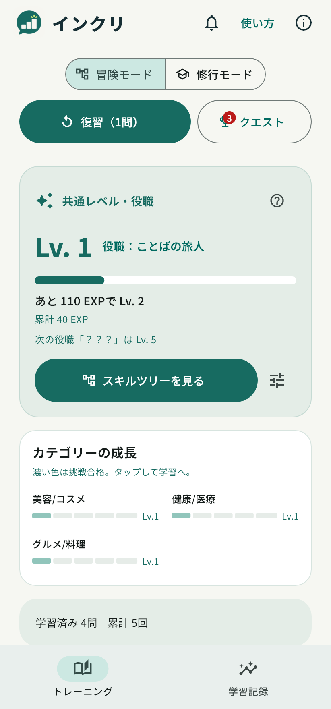
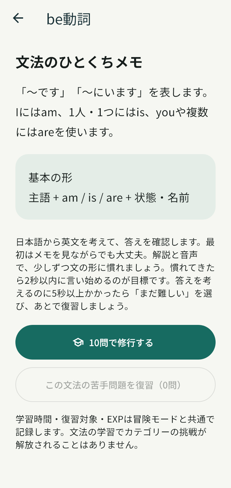
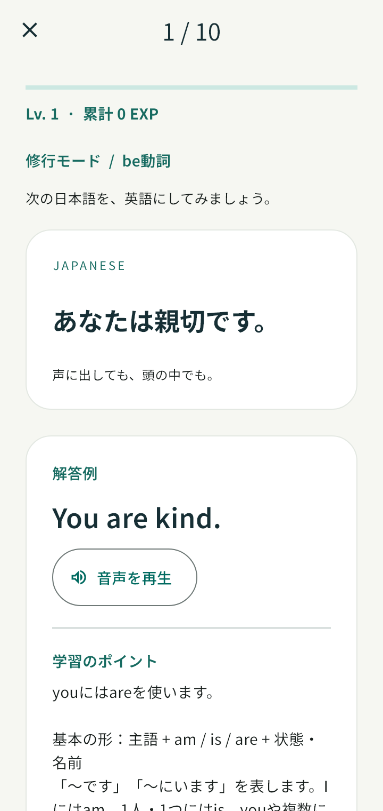
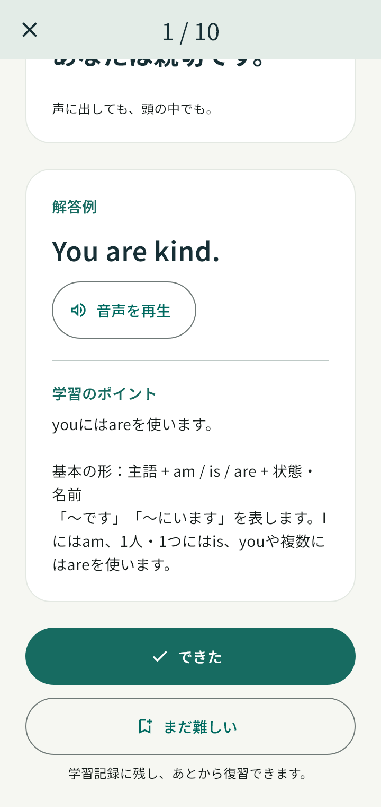
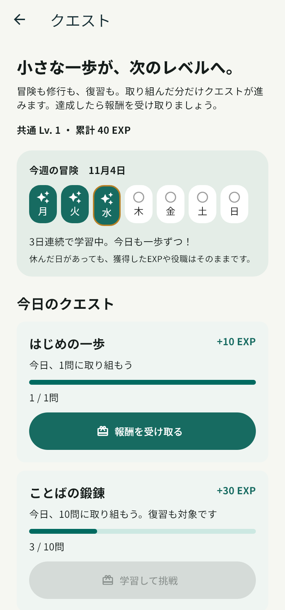

# インクリの使い方

トップ右上の「使い方」から、画面付きの5ページの説明を開けます。画像はタップで拡大できます。画面は説明用のサンプルです。

新規インストール後の初回起動では「使い方」が自動で開き、閉じると「学習リマインダー」が開きます。通知設定は任意で、初期状態はオフです。

## 1. 学習モードを選ぶ
英文の組み立て方を復習するなら「修行モード」、旅行や料理など興味のあるテーマで練習するなら「冒険モード」を選びます。

モードはいつでも切り替えられます。

## 2. 練習を始める
修行モードでは、学年と文法を選び、文法メモを確認します。「10問で修行する」を押すと練習が始まります。迷ったら「be動詞」から始めてみてください。

冒険モードでは、「スキルツリーを見る」を押し、テーマとレベルを選びます。

## 3. 日本語を英語にする
日本語を読んで、英語で言ってみましょう。慣れてきたら、2秒以内に英語で話し始めることを目指します。

「答えを表示」で解答例を確認できます。「音声を再生」を押すと、解答例の読み上げを聞けます。

## 4. 自己評価と復習
すぐに言えたら「できた」を選びます。言えなかった場合や、考えるのに5秒以上かかった場合は「まだ難しい」を選びます。解答や音声を確認する時間は含めません。

トップ画面の「復習」から苦手な問題に取り組めます。初期設定では、復習対象になってから「できた」が累計5回に達すると復習完了です。途中で「まだ難しい」を選んでも、積み上げた回数は維持されます。

完了に必要な回数は、iアイコンで開く「このアプリについて」の「復習設定」で変更できます。

## 5. レベルアップと挑戦
どちらのモードでも、練習で経験値がたまるとレベルが上がります。「クエスト」を達成すると報酬を受け取れます。

冒険モードでは、そのレベルの通常問題の8割（10問なら8問）で「できた」を選ぶと、挑戦問題に進めます。挑戦で5問中4問以上「できた」を選ぶと、次のレベルが解放されます。

## iアイコン：このアプリについて
日本語から英語を作る練習アプリです。登録不要で、問題とAI音声はオフラインで使えます。記録はこの端末に保存され、アプリ削除や機種変更で失われることがあります。英文は解答例で、ほかの表現でも伝えられます。

## 学習リマインダー
トップのベルから時刻を選び、「設定を保存」を押します。初期状態はオフです。「テスト通知」で届き方を確認できます。
